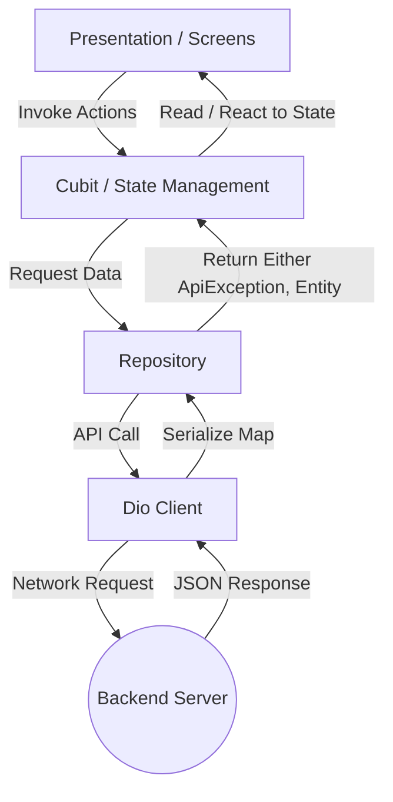
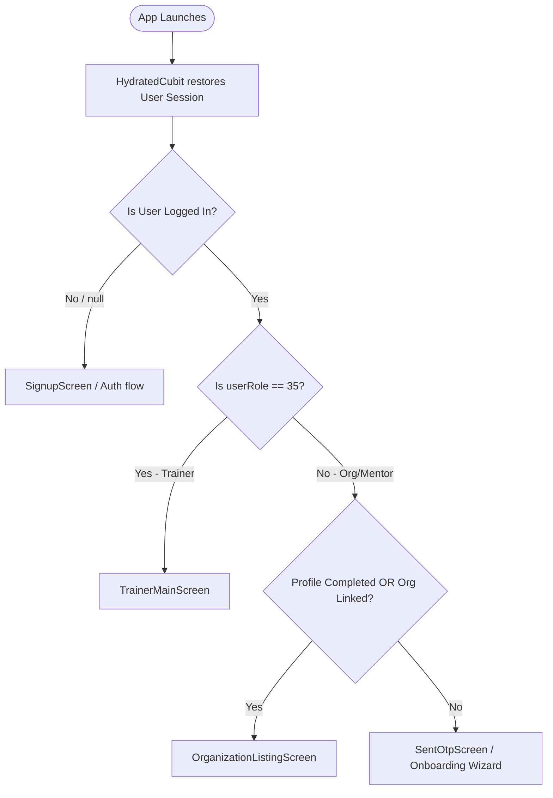

# Mentor Mobile App - Technical Documentation

Welcome to the technical documentation for the **Mentor Mobile App**, a fitness center, trainer, and member management platform built using Flutter. This document serves as a comprehensive developer guide explaining the codebase architecture, design patterns, core technologies, state management, security mechanisms, and module implementations.

---

## 1. Project Architecture & Structure

The codebase is organized using a **Feature-First / Clean Architecture** approach. This separates the application into self-contained vertical slices of business features, supported by a shared core horizontal layer.

### Directory Structure Overview
```
lib/
├── bootstrap.dart             # App initialization tasks (Hive, Hydrated Storage, Dotenv)
├── imports_bindings.dart      # Central exports of internal, external packages & global helpers
├── main_development.dart      # Entry point for development environment
├── main_staging.dart          # Entry point for staging environment
├── main_production.dart       # Entry point for production environment
├── core/                      # Core horizontal layer shared across features
│   ├── api/                   # Base API exceptions, Uris, common error handlers
│   ├── bloc/                  # Global BLoC observer
│   ├── constants/             # Centralized constant definitions and keys
│   ├── extensions/            # Dart core and Flutter extensions
│   ├── network/               # Dio HTTP client & security Interceptors
│   ├── services/              # External integrations (Google, files, notifications)
│   ├── storage/               # Secure Hive database initialization & management
│   ├── themes/                # Theme settings, styles, and custom color profiles
│   ├── utils/                 # JSON converters & common utilities
│   └── widgets/               # Shareable, generic UI components (buttons, shimmers, etc.)
└── src/
    ├── app/                   # Root App widget, MaterialApp setup, dynamic routing
    └── features/              # Vertical business features (Feature-First)
        ├── auth/              # Phone OTP Verification, Onboarding state
        ├── organization/      # Organization creation wizard, Details, Dashboards
        ├── settings/          # Support, Settings panels, FAQs
        ├── subscription/      # Subscription plans, Payments
        ├── trainer/           # Trainer profile, portfolio, certifications, dashboards
        └── workouts/          # Workout plan creation, assignment
```

### Vertical Feature Architecture
Each feature directory under `lib/src/features/` typically separates concerns into three layers:
1. **Domain / Models & Repositories**: Contains immutable entity classes (built via Freezed) and Repository classes communicating with external APIs.
2. **Cubit (State Management)**: Employs `Bloc` / `Cubit` to manage business logic. State is modeled with Option/Either types representing asynchronous data states.
3. **Presentation**: Views, screens, and localized widget components layout the user interface.



---

## 2. Dynamic Routing & App Bootstrapping

### App Initialization (`lib/bootstrap.dart`)
Before launching the Flutter application, `bootstrap()` runs essential initial setups:
- **Flutter Engine Binding**: Ensures system channels are ready via `WidgetsFlutterBinding.ensureInitialized()`.
- **Global Bloc Observer**: Sets `Bloc.observer` to track BLoC lifecycle events and state transitions.
- **Hydrated BLoC Storage**: Initializes standard persistent storage (`HydratedStorage`) in the app's cache directory.
- **Secure Storage (Hive)**: Configures and builds the encrypted local Hive DB instance (`LocalStorageService`).
- **Dotenv Initialization**: Loads configuration constants from the asset-packaged `.env` file.

### Entry Points
There are three main entry files corresponding to environments:
- [main_development.dart](file:///c:/Users/jasim/discipl_mentor/fluterrmenter-/lib/main_development.dart)
- [main_staging.dart](file:///c:/Users/jasim/discipl_mentor/fluterrmenter-/lib/main_staging.dart)
- [main_production.dart](file:///c:/Users/jasim/discipl_mentor/fluterrmenter-/lib/main_production.dart)

Each of these boots [AppView](file:///c:/Users/jasim/discipl_mentor/fluterrmenter-/lib/src/app/presentation/app_view.dart).

### Dynamic User Routing Flow
`AppView` dynamically resolves the home screen based on the current user state inside [AppCubit](file:///c:/Users/jasim/discipl_mentor/fluterrmenter-/lib/src/app/cubit/app_cubit.dart):



---

## 3. State Management & Functional Patterns

The application enforces functional programming techniques combined with the BLoC/Cubit pattern to maximize stability.

### The fpdart `Option<Either<L, R>>` Pattern
Instead of throwing exceptions across architecture boundaries, Repositories return an `Either` type from the `fpdart` library:
- **`Left`**: Contains a structured `ApiException` (defining the server error or network issue).
- **`Right`**: Contains the successful domain entity model returned.

In the **State Class** (annotated with `@freezed`), async actions are represented as:
- `Option<Either<ApiException, Entity>>? actionField`

This translates to three distinct UI states:
1. **Initial**: state field is `null` (no request has been initiated).
2. **Loading**: state field is `none()` (request is active, show progress spinner).
3. **Completed**: state field is `some(Either)` (request finished):
   - If `Left`, show the user-facing exception toast/error view.
   - If `Right`, show/use the parsed entity response.

*Example state definition:*
```dart
@freezed
class SentOtpState with _$SentOtpState {
  const factory SentOtpState({
    Option<Either<ApiException, SentOtpEntity>>? sentOtp,
    Option<Either<ApiException, void>>? googleSignIn,
  }) = _SentOtpState;
}
```

---

## 4. Network Layer & API Clients

All network communications use a singleton wrapper around the `Dio` library.

### `DioClient` Configuration
- Intercepts debug messages using a `PrettyDioLogger` and generates readable `CURL` command outputs (`CurlLoggerInterceptor`) inside terminal consoles.
- Configured with custom platform headers (`X-Platform`) and authorization scopes.

### Auto-Token Refresh Queuing Interceptor
The `AuthInterceptor` is registered with the `DioClient` to handle authorization headers seamlessly:
1. **Authorization Token Injection**: Automatically appends the `'Authorization': 'JWT <access_token>'` header if a valid session exists in `AppCubit`.
2. **JWT Auto-Refresh & Call Queuing**: If a requests fails with a `401 Unauthorized` response:
   - The interceptor sets a lock variable `_isRefreshing = true`.
   - Subsequent outgoing requests are temporarily stored inside an in-memory `_retryQueue`.
   - The interceptor executes `AppCubit.refreshToken()` using the active `refresh` token.
   - Upon successful token updates, it resubmits the original failing request and executes the queued requests with the updated token headers.
   - If the refresh token has expired, the user session is invalidated.

---

## 5. Data Encryption & Local Storage

The app employs local persistence using **Hive** combined with hardware-backed security.

### Encrypted Local Storage Architecture
Located in [local_storage_service.dart](file:///c:/Users/jasim/discipl_mentor/fluterrmenter-/lib/core/storage/local_storage_service.dart):
- **Encrypted Database at Rest**: High-speed database `Hive` is configured to run under AES-256 CBC encryption.
- **Hardware Security Key Integration**:
  - The encryption key is randomly generated using secure random bytes on the first boot.
  - This master key is immediately encrypted and persisted inside the platform’s secure vault (**Keystore** on Android, **Keychain** on iOS) using the `flutter_secure_storage` library.
  - On subsequent app launches, the raw key is read from secure storage and used to decrypt the database file.

---

## 6. Functional Business Modules

### 1. Authentication & Onboarding (`auth`)
Handles user validation:
- **Phone Login via OTP**: Sends custom OTP tokens via `sms_autofill` integration and processes confirmations.
- **Onboarding Setup Wizard**: If the profile is incomplete, guides the user step-by-step to insert basic demographics.

### 2. Organization Module (`organization`)
Designed for managing gym locations or fitness centers:
- **Creation Wizard**: Multi-step wizard containing:
  - Basic details (Name, Category, Bio).
  - Geographic Coordinates (Google Maps view coordinates selector).
  - Media uploader (Photos selection).
  - Operating shifts & Working schedules.
- **Detail View & Custom Components**: Configures class/gym details, packages, workout libraries, bank account updates, payment history, and reviews.

### 3. Trainer Module (`trainer`)
Provides dedicated pages for independent trainers:
- **Dashboard & Performance Statistics**: Detailed visual graphs reporting weekly/monthly trainers metrics.
- **Client & Verification management**: Handles client detail panels, trainer portfolio image updates, and profile completion checkpoints.

### 4. Workouts Management (`workouts`)
Supports training programming:
- **Workout Plan Architect**: Facilitates defining workouts, sets, reps, sequences, and re-ordering exercises.
- **Workout Plan Assignment**: Assigns plan templates to active members or leads.

### 5. Subscription & Payment (`subscription`)
Integrates monetization APIs:
- **Razorpay SDK Integration**: Coordinates checkout orders using standard Razorpay payment windows.
- **Billing History & Account Tier**: Tracks platform packages, payment receipts, and upgrade requirements.

---

## 7. Configuration & Developer Guidelines

### Code Generation
This project heavily depends on code generation for domain models (Freezed) and dependency mappings. Run the following command to generate the `.freezed.dart` and `.g.dart` files:
```powershell
dart run build_runner build --delete-conflicting-outputs
```

### Environment Parameters
Ensure dependencies and backend connections are configured using a `.env` file at the root directory:
```properties
RAZORPAY_API_KEY=rzp_live_...
RAZORPAY_API_SECRET=...
```

You can target a specific server location during build compilation using Flutter `--dart-define` keys:
```powershell
flutter run --dart-define=baseUrl=https://your-custom-backend.com
```
If not specified, the system defaults to the Render staging server: `https://discipl-backend.onrender.com`.

---
*Created by the Advanced Agentic Coding team using Antigravity.*
